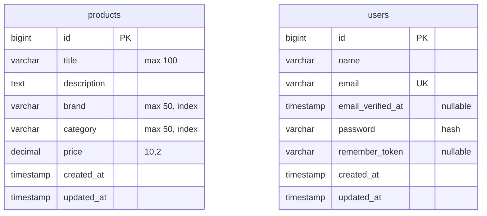

# Gaming Products Library

Laravel-project voor een bibliotheek met gamingmuizen, headsets en toetsenborden.
De bestaande Breeze-authenticatie verzorgt registratie, login en profielbeheer.
De vormgeving gebruikt Tailwind-utilities in Blade-componenten; `app.css` bevat alleen
de drie Tailwind-directives.

## Lokaal starten

Vereist: PHP 8.4 of hoger voor de vastgelegde ontwikkeldependencies, Composer en Node.js.

```sh
composer install
npm ci
```

Kopieer `.env.example` naar `.env` als je nog geen `.env` hebt. Bewaar bestaande instellingen.

```sh
php artisan key:generate
php artisan migrate
npm run build
php artisan serve
```

Open het adres dat Artisan toont. Bij gebruik van Herd open je het eigen `.test`-adres.
Voor het aanpassen van CSS/JavaScript kun je `npm run dev` gebruiken.

## Controleren

```sh
php artisan test
npm run build
php artisan route:list
```

Tests gebruiken een aparte SQLite-database in het geheugen. `.env`, `vendor`, `node_modules`
en lokale databasebestanden horen niet in Git.

## Projectkeuzes en planning

- Als bezoeker wil ik gamingproducten bekijken en een detailpagina openen.
- Als bezoeker wil ik op tekst zoeken en op merk/productsoort filteren om passende producten te vinden.
- Als gebruiker wil ik inloggen en mijn eigen profiel beheren via Breeze.
- Vervolg: als eigenaar wil ik mijn producten beheren; als gebruiker wil ik reviews plaatsen.

Les 1-2: eigen pagina's en MVC. Les 3: routes en controllers. Les 4: gedeelde layout,
partials en componenten. Les 5: productschema, Eloquent en databasegegevens tonen.
Relaties, eigenaarschap, reviews, rollen en aanvullende eindopdrachtregels zijn vervolgwerk
voor de latere lessen; deze planning is geen claim dat die onderdelen al af zijn.

## Catalogus vullen

```sh
php artisan migrate --seed
```

Dit voegt twaalf demo-producten toe. Opnieuw seeden maakt geen duplicaten en overschrijft
geen aangepaste producten of bestaande gebruikers. Registreer zelf een account via Breeze.
De bedragen zijn demonstratiedata, geen actuele winkelprijzen.

De catalogus ondersteunt zoeken in titel en beschrijving, gecombineerde merk- en
productsoortfilters, paginering en detailpagina's met een 404 bij een ontbrekend product.
De zeven resource-routes bestaan; aanmaken, bewerken en verwijderen via formulieren zijn
nog niet uitgewerkt en geven voorlopig HTTP 501. De publieke interface biedt deze acties niet aan.

Als CSS ontbreekt na het stoppen van Vite: verwijder het verouderde `public/hot`-bestand
en voer `npm run build` uit. Tijdens ontwikkeling maakt `npm run dev` dit bestand opnieuw.

## Datamodel na les 5



Dit toont de twee domeintabellen die nu bestaan; er is nog geen relatie tussen users en
products. Brand en category zijn in deze fase tekstvelden. De combinatie brand + title
is uniek. Laravel-tabellen voor sessies, wachtwoordherstel, cache en queues zijn hier weggelaten.
Normalisatie van merken/productsoorten, eigenaarschap en reviews horen bij het vervolg.
