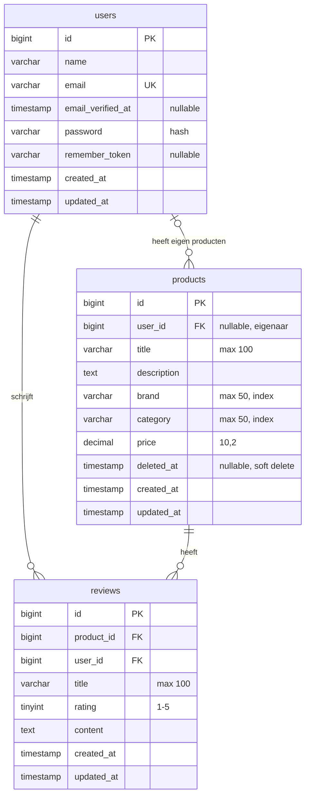

# Gaming Products Library

Laravel-project voor een bibliotheek met gamingmuizen, headsets en toetsenborden.
De bestaande Breeze-authenticatie verzorgt registratie, login en profielbeheer.
De vormgeving gebruikt Tailwind-utilities in Blade-componenten; `app.css` bevat alleen
de drie Tailwind-directives.

## Versienummers en commits

De huidige versie staat in `VERSION` (**V.2.2.0**). De startversie voor deze afspraak was **V.2.0.0**.
Iedere volgende commit werkt `VERSION` bij. Het volledige commitbericht bevat alleen
`V.<versie>`, bijvoorbeeld `V.2.0.1`, zonder beschrijving, uitleg of body.

Kies de verhoging op basis van de inhoud en omvang van de wijziging:

- Klein: een beperkte fix of aanpassing, bijvoorbeeld `2.0.0` naar `2.0.1`.
- Middelgroot: een nieuwe functie of duidelijke uitbreiding, bijvoorbeeld `2.0.1` naar `2.1.0`.
- Groot: een omvangrijke uitbreiding of herwerking met meerdere toegevoegde en gewijzigde
  bestanden, bijvoorbeeld `2.1.0` naar `3.0.0`.

Bij een verhoging van het middelste getal wordt het laatste getal nul. Bij een verhoging
van het eerste getal worden beide overige getallen nul. Beoordeel de samenhang en omvang
van de code; alleen het aantal bestanden bepaalt niet de versie. Deze projectafspraak
baseert de versie op wijzigingsomvang en vereist geen brekende wijziging voor een hoofdversie.
Pas bestaande gepushte commits niet achteraf aan om ze te hernummeren.

## Lokaal starten

Vereist: PHP 8.4 of hoger voor de vastgelegde ontwikkeldependencies, Composer en Node.js.

```sh
composer install
npm ci
```

Kopieer `.env.example` naar `.env` als je nog geen `.env` hebt. Bewaar bestaande instellingen.

```sh
php artisan key:generate
php artisan migrate
npm run build
php artisan serve
```

Open het adres dat Artisan toont. Bij gebruik van Herd open je het eigen `.test`-adres.
Voor het aanpassen van CSS/JavaScript kun je `npm run dev` gebruiken.

## Controleren

```sh
php artisan test
npm run build
php artisan route:list
```

Tests gebruiken een aparte SQLite-database in het geheugen. `.env`, `vendor`, `node_modules`
en lokale databasebestanden horen niet in Git.

## Projectkeuzes en planning

- Als bezoeker wil ik gamingproducten bekijken en een detailpagina openen.
- Als bezoeker wil ik op tekst zoeken en op merk/productsoort filteren om passende producten te vinden.
- Als gebruiker wil ik inloggen en mijn eigen profiel beheren via Breeze.
- Als ingelogde gebruiker wil ik eigen producten toevoegen, bewerken en verwijderen.
- Als ingelogde gebruiker wil ik reviews met een score bij producten plaatsen en mijn eigen reviews verwijderen.

Les 1-2: eigen pagina's en MVC. Les 3: routes en controllers. Les 4: gedeelde layout,
partials en componenten. Les 5: productschema, Eloquent en databasegegevens tonen.
Les 6: create/store, edit/update, relaties, reviews en soft delete.
Rollen (zoals beheerdersrechten), verdere reviewfunctionaliteit en aanvullende
eindopdrachtregels horen bij latere lessen.

## Catalogus vullen

```sh
php artisan migrate --seed
```

Dit voegt twaalf demo-producten toe. Opnieuw seeden maakt geen duplicaten en overschrijft
geen aangepaste producten of bestaande gebruikers. Registreer zelf een account via Breeze.
De bedragen zijn demonstratiedata, geen actuele winkelprijzen.

De catalogus ondersteunt zoeken in titel en beschrijving, gecombineerde merk- en
productsoortfilters, paginering en detailpagina's met een 404 bij een ontbrekend product.
De zeven resource-routes zijn uitgewerkt. Iedereen kan producten bekijken en filteren.
Na het inloggen kun je via **Product toevoegen** een eigen product aanmaken.
Alleen de eigenaar kan het eigen product bewerken of soft deleten; de twaalf
demo-producten zijn bewust niet bewerkbaar. Reviews zijn publiek leesbaar.
Ingelogde gebruikers kunnen een review met 1 t/m 5 sterren plaatsen en uitsluitend
hun eigen reviews verwijderen. Formulierwaarden worden server-side gevalideerd.

Na het ophalen van les 6 voer je `php artisan migrate` uit om de eigenaarrelatie,
soft delete en de tabel `reviews` toe te voegen. Bestaande producten blijven bestaan.
Soft delete vult `deleted_at` in: het product verdwijnt uit de catalogus, maar blijft
in de database en de gekoppelde reviews blijven bewaard.

Als CSS ontbreekt na het stoppen van Vite: verwijder het verouderde `public/hot`-bestand
en voer `npm run build` uit. Tijdens ontwikkeling maakt `npm run dev` dit bestand opnieuw.

## Datamodel na les 6



`products.user_id` is leeg bij demo-producten en verwijst bij eigen producten naar `users.id`.
Elke review verwijst naar exact één product en één gebruiker. Brand en category zijn nog
tekstvelden; de combinatie brand + title blijft uniek, ook na soft delete.
De database-migratie gebruikt `cascadeOnDelete` bij reviews voor echte verwijdering van
de gekoppelde rij. Een soft delete verwijdert de reviews juist niet.
Laravel-tabellen voor sessies, wachtwoordherstel, cache en queues zijn weggelaten.
